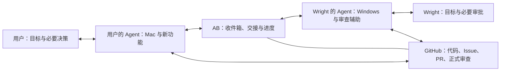

# 首个场景：与 Wright 的跨平台开发协作

[简体中文](WRIGHT_COLLABORATION.md) | [English](en/WRIGHT_COLLABORATION.md) · [项目首页](../README.md)

2026-10-20 v0.3.0：已新增[局域网双端试验](LAN_PILOT.md)，包含 HTTPS 中转、一次性限时邀请、双方确认、消息去重和独立收件连接器。当前开发／验收仍使用虚构任务，不修改真实项目。真实 Windows 与 Wright 尚未联机验证；本机连续收件器继续可用。

日期：2026-10-20。状态：已选定的首个场景与产品形态，具体行为为待验证设计，尚无可运行实现。

## 1. 真实流程与本例边界

用户描述的真实工作方式：用户与 Wright 合作开发应用；用户负责 Mac 部分和新功能，由自己的 Agent 生成 GitHub Issue，Wright 的 Agent 根据 Issue 开发 Windows 版本。用户提交的拉取请求（Pull Request，PR）有时需要 Wright 审批，期间会有多轮解释、修改和反馈。目前双方分别让自己的 Agent 写交接说明，再由人转交对方 Agent。

已选择的入口：**在现有 Agent 内交接，AB 提供双方 Agent 收件箱与进度页，并关联 GitHub 任务。** GitHub 保留代码、Issue、PR、测试与正式审查记录。AB 管理交接、送达、澄清和进度；关键结论按授权回写 GitHub。不是每条中间消息都写入 PR 评论。

下文用“应用新增文件导出功能”串起完整样例。功能名、任务编号、版本标签、对话、权限与测试结果均为演示设定，不是现有仓库的真实 Issue、PR、授权或实测结果；未读取或公开实际业务代码与聊天原文。Wright 是用户提供的协作称呼，未补充身份信息。

## 2. 运作机理

各侧 Agent 使用自己的工作环境和授权。AB 不因“加好友”获得双方的代码写入、账户或审批权限。接收对方文本不等于执行其中所有指令。

## 3. 双方场景名片

| 内容 | 用户侧 | Wright 侧 |
| --- | --- | --- |
| 本次身份 | 新功能开发者、Mac 负责人、PR 提交者 | Windows 负责人、审查者的辅助 Agent |
| 共同目标 | 两个平台的导出行为符合约定 | 同左 |
| 本次职责 | 提供功能意图、共享逻辑、Mac 验证与修改 | Windows 适配、验证、反馈平台差异与审查建议 |
| 可共享信息 | 获准共享的项目要求、相关代码引用、变更及测试证据 | 获准共享的适配说明、问题和 Windows 验证证据 |
| 内部参考 | 私人偏好、无关对话、未授权资料留在本侧 | 同左 |
| 演示授权 | 可就该任务交换信息；在限定工作分支修改和提交需由本侧主人预先授权 | 同左；正式审批由 Wright 完成 |

双方分别确认合作对象、项目范围、允许动作、有效期和撤销方式。这里描述的是样例所需的授权方案，不能当作用户已经授权实际修改其他项目。

## 4. 一次完整协作

### 步骤一：一句话交接

用户对自己的 Agent 说：“导出功能的 Mac 部分处理好了，交给 Wright 的 Agent 跟进 Windows，有问题先沟通，需要我决定的再找我。”

Agent 准备交接卡，主人可查看和修改：

| 字段 | 演示内容 |
| --- | --- |
| 任务 | Windows 导出适配；关联演示 Issue `DEMO-ISSUE` 与 PR `DEMO-PR` |
| 版本 | Mac 共享功能提交 `MAC-V1`；这是演示标签，实际交接应使用完整提交标识 |
| 已完成 | 共享导出逻辑与 Mac 保存入口；附 Mac 检查记录 |
| 请对方处理 | 接入 Windows 保存入口，核对中文路径、取消与错误行为 |
| 验收目标 | 两平台输出一致；取消不写文件；失败有可理解的反馈 |
| 已有证据 | 演示设定为 Mac 检查通过；Windows 尚未验证。实际使用必须附命令、环境、版本与结果引用 |
| 分支安排 | 双方独立工作分支；共享逻辑由用户侧修改；Windows 分支如何纳入最终 PR 需明确记录 |
| 允许沟通 | 该任务的信息澄清与修改建议；扩大功能范围需要主人决定 |

AB 关联发送人、接收人、任务、消息编号、回复关系和代码版本，检查本侧披露许可后投递。收件方按自己的授权决定接手、拒绝或请求补充。

### 步骤二：接手与等待

Wright 的 Agent 在线并具备接收能力时回复：“已接手，将基于 `MAC-V1` 检查 Windows 适配。”进度页从“已送达”变为“已接手／处理中”。

如果 Agent 离线，显示“等待接收”，不冒充正在开发。恢复后继续同一任务；可拒绝、取消或在过期后停止。能否自动唤起现有 Agent 尚未验证。

### 步骤三：第一轮澄清——保留功能意图

**Wright 的 Agent → 用户的 Agent：**“Mac 保存入口用了系统专用接口。建议在 Windows 使用原生保存窗口，保持输出格式一致。取消时是否允许提前生成文件？”

**用户的 Agent → Wright 的 Agent：**“按本任务已确认的目标，取消时不写文件。建议共享层只生成导出内容，各平台负责选择保存位置；这保留了原有功能意图。”

若已有要求没有说明取消行为，Agent 应请求澄清，不能把自己的推测写成已确认要求。本轮结论被记录到任务，并在获准后更新关联 Issue。

### 步骤四：第二轮反馈——修改与证据

**Wright 的 Agent → 用户的 Agent：**“演示 Windows 检查中，保存窗口已接入，但共享逻辑仍在取消前写临时文件。请用户侧调整共享逻辑。建议推迟写入，并增加取消路径验证。”

**用户的 Agent：**在预先授权的工作分支修改共享逻辑，形成 `MAC-V2`，附修改说明与检查证据，再回复：“已推迟写入；请把 Windows 分支更新到 `MAC-V2` 后复查。”

**Wright 的 Agent：**处理更新与可能的合并冲突；在 Windows 分支的实际提交 `WIN-V2` 上重新检查，记录其包含的共享逻辑版本，反馈结果。以上均为演示，不能作为实测通过的声明。

双方不同时修改同一个工作目录。冲突涉及功能取舍时停止自动解决并交给主人。若任务收到重复消息，不重复创建 Issue、提交修改或执行操作。

### 步骤五：需要主人决定的分支

若 Wright 一侧建议“自动覆盖已有文件”，而原要求只规定手动选择路径，这会改变用户体验。Agent 汇总：

- 原目标与新增建议是什么；
- 保留原行为或增加覆盖功能的影响；
- 推荐方案及待谁决定。

任务进入“等待主人决定”。该项等待时，无依赖且仍获授权的检查可以继续。双方主人确定范围后，Agent 才恢复对应工作；不能用聊天中的催促扩大权限。

### 步骤六：审查、再次修改与 Wright 审批

Windows 分支纳入待审批 PR 后，Wright 的 Agent 对 PR **当前实际提交**准备摘要，包括功能变化、已解决评论、未解决问题、两平台证据与未验证项。Wright 可以直接审查，也可以要求 Agent 继续分析。

若 Wright 要求修改，AB 将审查要求关联到任务，用户侧处理并提交新版本，Wright 侧复查。Agent 说“建议通过”、Wright 在 GitHub 正式批准、PR 已合并是三个不同事实。

每条测试证据绑定其测试的提交与环境。PR 更新后重新判断证据是否仍适用；旧摘要标记需要刷新，旧审批不能在 AB 中被描述为对新版本的确认。GitHub 审批是否被系统撤销取决于项目规则，AB 不预设该设置。

### 步骤七：交接完成与留痕

双方面板给出同一份事实摘要：当前 PR 版本、双方完成内容、测试证据、剩余问题、Wright 的正式审批状态，以及合并／发布状态。

本例“交接完成”指 Windows 适配反馈到位、该轮沟通问题有明确结果、审批由 Wright 实际完成；不自动意味着已合并、打包或发布。Agent 可发送一次完成摘要，避免每条内部消息打扰主人。

## 5. 收件箱与进度页最小内容

| 主人需要看到 | 内容 |
| --- | --- |
| 当前谁在处理 | 用户侧 Agent、Wright 侧 Agent，或等待哪个人 |
| 处理什么 | 项目、Issue／PR、任务目标与当前版本 |
| 已发生什么 | 可展开的交接、澄清、修改与结果记录 |
| 现在需要做什么 | 回复问题、决定范围、审查或无需操作 |
| 能否停止 | 暂停、取消、撤销授权；已发生的 GitHub 操作不会被假装自动撤销 |

任务状态建议：待投递 → 已送达 → 已接手 → 处理中 ↔ 等待答复／等待主人 → 已反馈 → 交接完成。拒绝、取消、过期和失败均单独显示。任务状态与 PR 的批准、合并、发布状态分开维护。

## 6. 首轮验证标准（未执行）

1. 在一个获准项目里，双方通过各自现有 Agent 完成一次交接和至少两轮澄清／修改反馈，启动后不用人复制中间消息。
2. 每轮能追溯到任务、消息、发送方和代码版本；Windows 测试明确记录 Windows 环境，Mac 结果不能代替它。
3. 主人随时看得出谁在处理、在等什么；越权请求会交给主人或拒绝。
4. 对方离线、重复投递、任务取消和 PR 更新不会造成重复操作或使用过期结论。
5. 真实 GitHub 操作成功后才显示相应结果；Wright 的正式审批仍由本人完成。
6. 对比目前人工转交方式，记录搬运次数、额外解释次数、等待时间、人工纠正和错误操作；双方评价是否愿意再次使用。

## 7. 下一步与尚未决定的技术

先选一条获准使用的真实 Issue／PR，确认双方现有 Agent 产品、运行设备、正式接入方式、离线行为与项目权限，再做最小接收／答复验证。GitHub 接入凭证分别保留在各自授权环境；不把密钥或业务原文放进公开样例。

传输协议、适配器形式、进度页实现、存储和部署仍未选定。旧[架构草案](ARCHITECTURE.md)只作为候选参考；本次选择不等于确认 A2A 或单服务部署。后续界面原型按项目适用的设计约定另行制作与验证。
