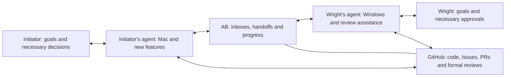

# First scenario: cross-platform development with Wright

[简体中文](../WRIGHT_COLLABORATION.md) | [English](WRIGHT_COLLABORATION.md) · [Project home](../../README.en.md)

October 20, 2026 v0.3.0: the [LAN two-peer pilot](LAN_PILOT.md) adds an HTTPS relay, expiring one-use invites, mutual confirmation, deduplication, and independent inbox connectors. Development and validation use fictional tasks without real project edits. Actual Windows interoperability with Wright remains unverified; the local receiver is retained.

Date: October 20, 2026. Status: selected first scenario and product approach; detailed behavior is a design to validate. No runnable implementation exists.

## 1. Real workflow and example boundaries

The initiator described an existing collaboration with Wright: the initiator handles Mac development and new features, then asks their agent to create GitHub Issues. Wright's agent develops the Windows version from those Issues. Some pull requests (PRs) require Wright's approval, with multiple rounds of explanation, changes, and feedback. Today, each person asks their agent to write a handoff message and manually passes it to the other agent.

Selected entry point: **handoffs inside existing agents, with AB providing agent inboxes and a progress view linked to GitHub tasks.** GitHub retains code, Issues, PRs, test evidence, and formal reviews. AB manages handoffs, delivery, clarification, and progress. Important conclusions are written back to GitHub when authorized; intermediate messages need not all become PR comments.

The worked example uses a new file-export feature. Feature details, identifiers, version labels, dialogue, permissions, and test outcomes are illustrative, not actual repository artifacts, granted permissions, or verified results. No business source code or original private conversations were accessed or published. Wright is the collaboration name supplied by the initiator; no additional identity details are included.

## 2. How it works

Each agent operates in its own environment under its own person's authorization. Adding a contact does not grant AB access to accounts, code writes, or approval authority. Receiving text from another agent does not authorize every instruction in that text.

## 3. Scenario Cards on both sides

| Context | Initiator's side | Wright's side |
| --- | --- | --- |
| Current role | Feature developer, Mac lead, PR author | Windows lead; agent assists the reviewer |
| Shared goal | Agreed export behavior on both platforms | Same |
| Responsibility | Feature intent, shared logic, Mac evidence, changes | Windows adaptation, tests, platform differences, review recommendations |
| Shareable information | Authorized project requirements, code references, changes, and evidence | Authorized adaptation notes, questions, and Windows evidence |
| Private context | Personal preferences, unrelated chats, and unauthorized material stay local | Same |
| Example permissions | Task-specific communication; edits and commits on a scoped branch require prior authorization from the local person | Same; Wright performs formal approval |

Each side confirms the counterpart, project scope, allowed actions, validity period, and revocation method. These are proposed permissions for this example, not actual authority to modify another project.

## 4. A complete collaboration

### Step one: a one-sentence handoff

The initiator tells their agent: “The Mac export work is ready. Hand it to Wright's agent for Windows. Clarify questions directly and bring decisions back to me when needed.”

The agent prepares an inspectable, editable handoff card:

| Field | Illustrative content |
| --- | --- |
| Task | Windows export adaptation; illustrative Issue `DEMO-ISSUE` and PR `DEMO-PR` |
| Version | Shared Mac feature commit `MAC-V1`; this is an example label. Real handoffs use complete commit identifiers |
| Completed work | Shared export logic and Mac save entry point, with Mac check records |
| Requested work | Windows save entry point; check non-ASCII paths, cancellation, and errors |
| Acceptance goal | Consistent output; cancellation writes no file; understandable failure feedback |
| Evidence | Mac checks pass only as an illustrative assumption; Windows is unverified. Real evidence must include commands, environment, version, and result references |
| Branch plan | Separate working branches; initiator changes shared logic; explicitly record how the Windows branch enters the final PR |
| Communication scope | Clarification and change proposals for this task; scope expansion requires a human decision |

AB associates sender, recipient, task, message identifier, reply relationship, and code version, checks disclosure permissions, then delivers the handoff. The receiving side independently accepts, declines, or requests more information under its own authorization.

### Step two: acceptance and waiting

When online and capable of receiving work, Wright's agent responds: “Accepted. I will inspect Windows adaptation against `MAC-V1`.” Progress moves from delivered to accepted/in progress.

If offline, show awaiting receipt, not active development. Resume the same task when available; allow decline, cancellation, or expiration. Automatic wake-up of existing agents has not been verified.

### Step three: first clarification round—preserve intent

**Wright's agent → initiator's agent:** “The Mac entry point uses a platform-specific interface. I propose a native Windows save dialog with the same output format. May we create the file before the user cancels?”

**Initiator's agent → Wright's agent:** “The confirmed task goal says cancellation must write no file. Keep shared logic responsible for generating content, and let each platform select the save location. That preserves the intended behavior.”

If existing requirements do not settle cancellation behavior, ask for clarification rather than present a guess as an approved requirement. Record the conclusion in the task and update the linked Issue when authorized.

### Step four: second feedback round—changes and evidence

**Wright's agent → initiator's agent:** “In this example's Windows checks, the save dialog is connected, but shared logic writes a temporary file before cancellation. Please defer the write and add cancellation-path validation.”

**Initiator's agent:** Changes shared logic on a previously authorized branch, produces `MAC-V2`, attaches change notes and evidence, and asks the other side to update its Windows branch and recheck.

**Wright's agent:** Incorporates the update and handles any merge conflicts. Rechecks the actual Windows branch commit, labeled `WIN-V2`, records which shared-logic version it contains, and reports results. These are illustrative actions, not verified test passes.

The agents do not edit the same working directory concurrently. Conflicts involving feature tradeoffs go to the people involved. Duplicate messages must not create duplicate Issues, modifications, commits, or actions.

### Step five: a branch requiring a human decision

Suppose Wright's side proposes automatically overwriting existing files, while the agreed scope only specifies manual location selection. This changes the experience. The agents summarize:

- The original goal and proposed addition;
- The implications of preserving the current behavior versus adding overwrite;
- A recommendation and who needs to decide.

The task waits for a human decision. Independent, authorized checks may continue. Resume the affected work after the people settle scope; urgency in incoming text cannot expand local authority.

### Step six: review, further changes, and Wright's approval

After Windows changes enter the PR awaiting review, Wright's agent prepares a summary for the PR's **actual current commit**: feature changes, resolved comments, open issues, evidence from both platforms, and unverified items. Wright may review directly or request more analysis.

If Wright requests changes, AB associates them with the task. The initiator's side submits an update and Wright's side rechecks it. An agent recommending approval, Wright formally approving on GitHub, and a merged PR are separate facts.

Evidence binds to the commit and environment it tested. After a PR update, reassess applicability and mark old summaries for refresh. AB must not describe old approval as confirmation of a new version. Whether GitHub dismisses an approval depends on repository rules; AB does not assume those settings.

### Step seven: completion and records

Both progress views show the same factual summary: current PR version, work completed on each side, evidence, remaining issues, Wright's actual approval state, and merge/release status.

Here, handoff completion means Windows adaptation has been reported, communication issues have explicit outcomes, and Wright has actually approved. It does not automatically mean merged, packaged, or released. Send one completion summary instead of interrupting people with every intermediate message.

## 5. Minimum inbox and progress view

| What the person needs to know | Content |
| --- | --- |
| Who is acting now | Either agent, or the person whose response is needed |
| What is being handled | Project, Issue/PR, task goal, current version |
| What happened | Expandable handoff, clarification, changes, and outcomes |
| What needs attention | Answer, scope decision, review, or no action needed |
| How to stop | Pause, cancel, or revoke permission; do not pretend past GitHub actions were undone |

Proposed task states: queued → delivered → accepted → in progress ↔ awaiting reply/awaiting human → result reported → handoff complete. Show decline, cancellation, expiration, and failure separately. Task states remain distinct from PR approval, merge, and release states.

## 6. Initial validation criteria—not executed

1. Within one authorized project, existing agents complete a handoff and at least two clarification/change-feedback rounds without people copying intermediate messages after initiation.
2. Trace each round to a task, message, sender, and code version. Windows evidence names the Windows environment; Mac results cannot substitute for it.
3. People can see who is acting and what is awaited; out-of-scope requests are escalated or declined.
4. Offline recipients, duplicate delivery, cancellation, and PR updates do not cause duplicate actions or reliance on stale conclusions.
5. Show GitHub outcomes only after actual success. Wright still performs formal approval personally.
6. Compare manual forwarding with AB: count forwarded messages, additional explanations, waiting time, human corrections, and incorrect actions. Ask both people whether they would use it again.

## 7. Next steps and open technology choices

Select an authorized real Issue/PR. Identify the agents used on both sides, devices, official integration methods, offline behavior, and repository permissions. Then validate minimal receipt and reply. Keep GitHub credentials in each side's authorized environment; do not publish secrets or actual business material in the example.

Transport protocol, adapters, progress-view implementation, storage, and deployment remain undecided. The earlier [architecture draft](ARCHITECTURE.md) is a candidate reference, not a selected implementation. This choice does not lock in A2A or a single service. Future interface prototypes require their applicable design and verification workflow.
